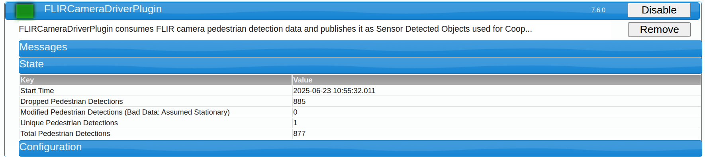
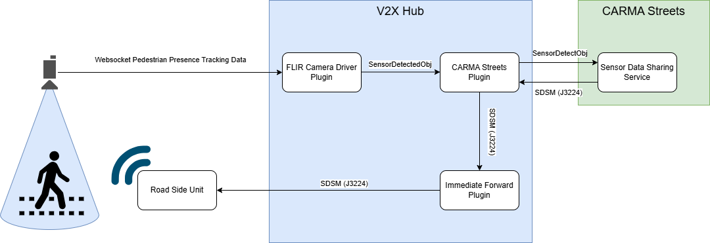

# FLIR Camera Driver Plugin Documentation

## Introduction
The FLIR Camera Driver Plugin is the hardware interface for the FLIR Sensor. It contains logic to translate FLIR Sensor Pedestrian Presence Tracking information into V2X Hub Sensor Detections. These detections can be consumed by downstream plugins or services for J2735 Message Generation. Currently this is support by the [CARMA Streets](https://github.com/usdot-fhwa-stol/carma-streets) [Sensor Data Sharing Service](https://github.com/usdot-fhwa-stol/carma-streets/tree/develop/sensor_data_sharing_service) which will generate SDSMs

## Related Plugins

A list of plugins related to the FLIR Camera Driver Plugin.

### Immediate Forward Plugin

For RSU Immediate Message Forwarding (IMF) functionality forward any generated J2735 message to RSU (e.g. SDSM)

### CARMA Streets Plugin

The CARMA Streets plugin is required for SDSM generation since this is handled by the [CARMA Streets](https://github.com/usdot-fhwa-stol/carma-streets) [Sensor Data Sharing Service](https://github.com/usdot-fhwa-stol/carma-streets/tree/develop/sensor_data_sharing_service). For this functionality the FLIR Camera Driver Plugin generates Sensor Detected Object messages, which are forwarded to the Sensor Data Sharing service via the CARMA Streets plugin. The Sensor Data Sharing Service then generates SDSMs which are sent back to V2X Hub via the CARMA Streets Plugin  and broadcast to the RSU via the Immediate Forward Plugin.


## Configuration/Deployment

This plugin has several configuration parameters. Below these are listed out as together with descriptions on how to set them.

**FLIRConfigurations**: JSON string configuration parameters which contains on or more FLIR Camera(s) to connect to.

```json
[
  {
    "WebSocketHost": "127.0.0.1", // IP Address of FLIR Camera
    "WebSocketPort": "8081", // Websocket port
    "Endpoint": "/api/subscriptions", // Websocket endpoint
    "CameraRotation": 16.13, // Camera heading measure in degrees clockwise from North
    "SensorId": "FLIR_Turner_Parking_Lot" // Sensor Id 
  },
  {
    "WebSocketHost": "127.0.0.1",
    "WebSocketPort": "8082",
    "Endpoint": "/api/subscriptions",
    "CameraRotation": 11.13,
    "SensorId": "FLIR_Crosswalk"
  }
]
```

**LinkStallThresholdMs** (default 500, minimum 200): camera link monitoring threshold. A camera frame that spent this many milliseconds longer in transit than the frame before it, while the camera kept producing frames, is logged as a link stall. Frames this much later than normal are counted as late. 500 ms matches the freshness limit the CARMA Streets Sensor Data Sharing Service applies before discarding detections.

## Status Information

This plugin includes some custom status information to allow for real-time monitoring of FLIR Camera detection data. Included are:

**Dropped Pedestrian Detections** : A complete count of all pedestrian detections from all FLIR Camera connections that were dropped due to inability to process the information
**Modified Pedestrian Detections (Bad Data: Assumed Stationary)**: A complete count of all pedestrian detections from all FLIR Camera connections that were modified due to bad incoming data.
> [!NOTE]  
> We only modify incoming detections that have incomplete/invalid heading/speed information. After testing we have found that occassionally, when a detected object stops, the FLIR Camera will continue to broadcast detections that **do not** include angle or heading but **do** include speed. This seems to be a bug that only occurs for stationary objects intermittently. To address this, when no angle is provided, we assume speed is 0. For tracebility we have added this status as well as a flag in each SensorDetectedObjectMessage which indicates whether we have modified the detection data from the source sensor at all.
**Unique Pedestrian Detections**: A complete count of all pedestrian detections from all FLIR Camera connections that are unique. We evaluate this by comparing the incoming detection ids to the previously received ids. This is meant to be a rough estimate of all pedestrians detected by the FLIR Cameras connected.
**Total Pedestrian Detections**: A complete count of all pedestrian detections from all FLIR Camera connections. This includes any detections that where dropped or modified.
**Live number of currently detected pedestrians**: A current/live count of unique pedestrian detections from all FLIR Camera connections.

The following camera link statuses are totals since the camera connections started (see [Camera Link Monitoring](#camera-link-monitoring)):

**Camera Link Stalls**: Number of times the camera kept producing frames but none arrived for at least `LinkStallThresholdMs`, after which the backlog arrived together.
**Camera Link Longest Stall (ms)**: Longest time frames were held in transit.
**Camera Link Last Stall (UTC)**: Start and end of the most recent stall, for matching against packet captures and network logs.
**Camera Link Late Frames**: Frames that arrived at least `LinkStallThresholdMs` later than normal. Detections in these frames are likely discarded downstream as stale.
**Camera Link Minor Holds**: Frames held 150 ms to `LinkStallThresholdMs` in transit. About 200 ms is the signature of a single TCP retransmission, so a rising count is an early sign of packet loss on the camera link.
**Camera Missing Frames**: Gaps in the camera's `dataNumber` sequence while it was tracking continuously.




## Design


Above is a diagram illustrates how the FLIR Camera Driver Plugin is used to create Sensor Data Sharing Messages (SDSM) for Cooperative Perception.

### Messages

**SensorDetectedObject**: V2X Hub message that contains detection data. Can be used to generate other messages like SDSM.

**SensorDataSharingMessage**: V2X Cooperative Perception message defined in the J3224 standard.

## Camera Link Monitoring

The camera streams tracking data over a WebSocket (TCP). If packets are lost on the camera link, TCP holds back everything after the lost packet until a retransmission gets through, so detections stop for a few seconds and then arrive all at once. Downstream services discard detections that late, which shows up as a gap followed by a burst on the detection topic.

The plugin compares when each frame arrives with the camera's own `time` field. It compares differences between consecutive frames rather than absolute times, so it does not depend on the camera and V2X Hub clocks being synchronized. It logs:

* `WARNING ... FLIR link stall on <sensor>: no data for 3583 ms while the camera kept producing frames 100 ms apart, so frames were held 3483 ms in transit. Stall from <start> to <end> ...`: the camera kept producing frames but none arrived. Start and end are UTC; use them to look up the same moment in a packet capture, ping log or switch log.
* `WARNING ... FLIR late burst on <sensor>: 26 frame(s) arrived at least 500 ms later than normal ...`: the backlog delivered after a stall.
* `INFO ... FLIR link minor hold on <sensor>: frame held 200 ms in transit ...`: usually one TCP retransmission.
* `DEBUG ... FLIR camera frames missing on <sensor>: dataNumber ...`: gaps in the camera's frame sequence.

### Pinpointing where frames are held

`scripts/flir_stream_probe.py` uses only the Python standard library.

**live** subscribes to the camera as a second, independent client and at the same time keeps opening TCP connections to the camera and to optional control hosts. Run it on the V2X Hub host while testing:

```shell
python3 scripts/flir_stream_probe.py live --host <camera-ip> --control <other-host-on-same-switch>:<open-port>
```

For each stall it prints whether the camera stayed reachable and how the backlog arrived at the TCP level, and writes `events.jsonl`, `frames.csv` and `chunks.csv`:

* Camera unreachable while the control host answered: packets were lost between the switch and the camera (camera network interface, its cable, PoE/BPL link or switch port).
* Camera and control host both unreachable: the problem is on the V2X Hub host or in shared network equipment.
* Camera reachable throughout: the network path was up; frames were held by the camera's sender or by TCP retransmission backoff.

If the plugin logs a stall at a time when the probe did not see one, the frames were held on the V2X Hub host. Running the probe on a laptop on the same switch separates the camera's link from the V2X Hub host's link.

**analyze** finds stalls in existing logs and cross-checks them:

```shell
python3 scripts/flir_stream_probe.py analyze --v2xhub <v2xhub log> --sdss <sensor data sharing service log> \
    --other-traffic <kafka export of another topic, e.g. v2xhub_bsm_in.log> --probe-events <live run>/events.jsonl
```

It reads the plugin's stall warnings, or the DEBUG `Received:` lines of older builds (plugin `LogLevel` DEBUG, single camera). Per stall it reports how many detections the Sensor Data Sharing Service discarded as stale, whether other traffic kept arriving (which rules out the V2X Hub host stalling as a whole), and whether the probe saw the same stall.


## Functionality Testing
In the `./scripts/` directory in this plugin we have created a simply python script that mocks the websocket hosted by the FLIR Camera for pedestrian presence tracking. To confirm plugin functionality this script can be used to mock the output of the FLIR Camera

1) Install Python3 and Pip.
2) Run `python3 -m pip install -r scripts/requirements.txt` to install depedencies.
3) Run `python3 scripts/mockFLIRCamera.py --ip <ip> --port <port>`
4) Configure FLIR Camera Driver Plugin for connection to the websocket and in the **Messages** tab of the plugin you should see Sensor Detected Objects publishing.

To test camera link monitoring, add `--stall-every <seconds> --stall-ms <milliseconds>` to the mock. It then periodically holds the messages it produces for the given time and sends them all at once. The plugin should log a `FLIR link stall` and a `FLIR late burst` for each one, and the **Camera Link** statuses should count them. 
