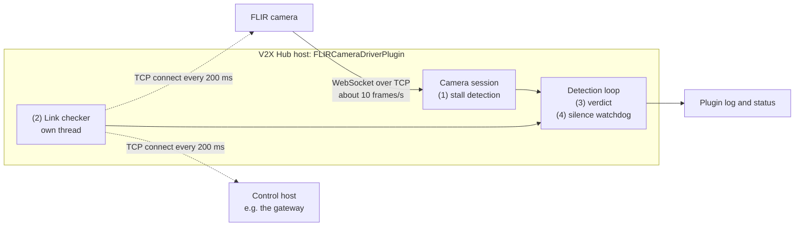
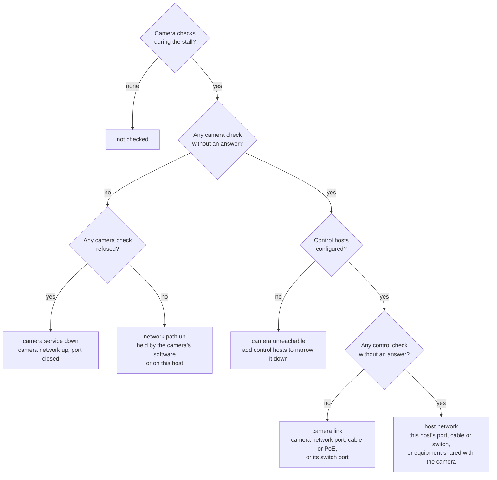

# Camera Link Monitoring Design

## Problem

The FLIR camera streams pedestrian tracks to this plugin over a WebSocket, which is a single TCP connection carrying about 10 frames per second. When packets on that connection are lost, TCP holds back every later frame until a retransmission gets through. The retransmission timeout doubles after each failed attempt (resends at about 0.2, 0.6, 1.4 and 3.0 s after the loss), so an outage of well under a second can hold the stream for several seconds. The held frames then arrive all at once. The CARMA Streets Sensor Data Sharing Service (SDSS) discards detections older than 500 ms, so each stall shows up as a gap in the published detections.

Field data showed detections stalling for about 3.5 s at a time, and in a separate test a camera stopped answering on the network for 6 minutes while it kept running and other hosts on the same network stayed reachable. A stall can come from:

* the camera's link: the camera's network port, its cable or PoE, or its switch port,
* the V2X Hub host's side of the network: its network port, cable or switch,
* software at either end: the camera's sender, or this plugin.

A packet capture on the V2X Hub host shows what TCP did, but not which of these was at fault, and it has to be running when the stall happens. Stalls can be hours apart, so the plugin should record the evidence itself, every time.

## Goals

* Detect every stall on each camera connection and log when it started and ended, in UTC.
* For each stall, tell whether the network path to the camera was up, using checks that run independently of the stream.
* Detect a camera connection that has gone silent. Today the plugin never notices.
* Keep it small: C++ and Boost.Asio only, no new dependencies, negligible network load.

Non-goals:

* Fixing the stalls. This work finds where they come from.
* Reconnecting a dead connection (see [Related issues](#related-issues)).
* Replacing packet captures or switch logs. The plugin's log gives the times to look up in them.

## Overview



Four parts, each in its own PR after this one:

1. **Stall detection**: each camera session compares when a frame arrives with when the camera produced it.
2. **Link checks**: a separate thread keeps opening TCP connections to each camera and to optional control hosts.
3. **Verdict**: for each stall, the plugin looks up the link checks that ran while the frames were held and logs where they were held.
4. **Silence watchdog**: the plugin warns when a camera connection carries nothing at all, not even keepalive pings.

## 1. Stall detection

For each data frame the session records when it arrived on this host (`recv`) and the camera's `time` field (`cam`). For consecutive frames:

```
hold = (recv - prev_recv) - (cam - prev_cam)
```

`hold` is how much longer the frame spent in transit than the frame before it. Each difference uses a single clock, so the camera and host clocks do not need to be synchronized: a constant offset between them cancels out. A frame with `hold >= LinkStallThresholdMs` (default 500 ms) ends a stall, which lasted from `recv - hold`, when the frame would have arrived with the same transit time as the frame before it, to `recv`.

The formula also covers outages that begin while the camera is idle. The camera sends no data frames while nothing is tracked, so `cam - prev_cam` is large, but the first frame it produces during an outage is still held, and its hold is measured the same way.

500 ms matches the SDSS freshness limit: frames held less than that still reach SDSS in time. TCP usually recovers a single lost packet within about 200 ms, so a lower threshold mostly reports single retransmissions.

A stall from field data. The camera produced frames 100 ms apart, but nothing arrived for 3583 ms:

| dataNumber | Camera `time` (UTC) | Arrived (UTC) | Arrival gap (ms) | Camera gap (ms) | Hold (ms) |
|---|---|---|---|---|---|
| 50650 | 17:47:10.032 | 17:47:10.036 | 100 | 100 | 0 |
| 50652 | 17:47:10.132 | 17:47:13.619 | 3583 | 100 | **3483** |
| 50653 | 17:47:10.232 | 17:47:13.620 | 1 | 100 | -99 |

The plugin logs it as:

```
WARNING FLIR link stall on FLIR_North: frames held 3483 ms in transit, from 2026-09-15T17:47:10.136Z to 2026-09-15T17:47:13.619Z (the camera produced the held frame 100 ms after the previous one).
```

## 2. Link checks

Every `LinkCheckIntervalMs` (default 200 ms) the link checker opens a TCP connection to each target and closes it as soon as it is established. The targets are:

* each camera, on its WebSocket port,
* the optional control hosts in `LinkCheckControlHosts`: other devices on the same network, such as the gateway or another device on the camera's switch.

Each check has one of three outcomes:

| Outcome | Meaning |
|---|---|
| answered | The connection was established within the interval. |
| refused | The host replied with a reset: its network is up, but nothing listens on the port. For a camera, this means the camera's web service is down. For a control host it counts as answered, because the reply proves the path is up; any port works. |
| no answer | No reply within the interval, or an error such as "host unreachable". |

A check must finish within one interval, so at most one check per target is in flight. The next check starts one interval after the previous one started.

Check results are kept in memory for 15 minutes per target (about 4,500 results), long enough to cover any stall. A run of failed checks is logged when it starts and when it ends, which records outages even while the camera is idle:

```
WARNING FLIR link check: camera FLIR_North (192.168.55.83:80) stopped answering at 2026-11-10T14:18:02.200Z: no answer within 200 ms.
WARNING FLIR link check: camera FLIR_North (192.168.55.83:80) answering again at 2026-11-10T14:24:11.400Z, after 1846 failed checks over 369200 ms.
```

### Interval and timeout

The first prototype, a Python probe, checked every 500 ms with a 3 s timeout. The plugin checks every 200 ms and waits at most 200 ms for each check:

* **Healthy connections are fast.** On the test network, 25,395 checks over 1.2 hours to a camera, the gateway and the probing host all completed in 4 ms or less. A 200 ms deadline leaves a 50× margin.
* **A lost packet fails the check.** Linux resends a lost connection request (SYN) only after 1 s. With a 200 ms deadline, a check whose SYN or SYN-ACK was lost fails. With a 3 s timeout it would succeed late, after the resend, and need a separate "slow" threshold to be noticed.
* **Every outage that can cause a stall is caught.** TCP usually recovers a single lost packet within about 200 ms. A hold of 500 ms or more means the retransmissions were lost too, so the link was losing packets for at least a few hundred milliseconds, and a check starts within any 200 ms. With checks every 500 ms, a 400 ms outage can fall between two of them.
* **The verdict is ready sooner**: one interval after the stall ends, not 3 s.
* **The cost is small**: 5 connections per second per target, about 35 small packets or 2 kB per second.

The trade-off: "host unreachable" (no ARP reply) takes about 3 s to be reported, so with a 200 ms deadline the check reports "no answer" instead. Both mean the host did not answer, and the verdict does not need the distinction.

If the path to the camera has round trips longer than about 50 ms, e.g. a cellular or radio backhaul, raise `LinkCheckIntervalMs`.

### No self check

The prototype also checked the host's own address, to catch the host itself losing its network. V2X Hub runs in a Docker container on a bridge network: the container's own address and its default gateway are virtual and stay up when the host's network port goes down. A control host on the real network covers that case instead: when the camera and the control host stop answering together, the problem is on the host's side.

## 3. Verdict

For each stall, once the link checks that overlap it have finished, the plugin counts the camera's and the control hosts' checks during the stall and classifies the stall:



How a stall caused by the camera's link looks to the plugin:

```mermaid
sequenceDiagram
    participant Cam as Camera
    participant Session as Camera session
    participant Checker as Link checker
    participant Loop as Detection loop
    Cam->>Session: frame N, on time
    Note over Cam: link down
    Cam--xSession: frame N+1 lost
    Checker--xCam: connect, no answer
    Checker->>Checker: control host answered
    Note over Cam: link back up
    Cam->>Session: frames N+1 to N+35 together
    Session->>Loop: stall, frames held 3483 ms
    Note over Loop: waits until the checks covering the stall have finished
    Loop->>Checker: checks during the stall?
    Checker-->>Loop: camera answered 11 of 17, control hosts 17 of 17
    Loop->>Loop: log the stall's verdict: camera link
```

The log line names the verdict, explains it and gives the check counts:

```
WARNING FLIR link stall on FLIR_North from 2026-09-15T17:47:10.136Z to 2026-09-15T17:47:13.619Z: camera link. The camera stopped answering while the control hosts answered, so packets were lost between the network and the camera: its network port, its cable or PoE, or its switch port. Link checks during this time: camera answered 11 of 17, control hosts 17 of 17.
```

Confidence grows with the stall's length. A 3.5 s stall overlaps about 17 camera checks; if the camera answered all of them, the network path was up throughout and the frames were held in software. Loss that hits only the large data frames and not the small connection packets, such as an MTU mismatch, would not show up in the checks.

The same classification is logged when a run of failed camera checks ends, which covers outages while the camera was idle.

## 4. Silence watchdog

While nothing is tracked the camera sends no data frames, but it sends a WebSocket ping every 60 s. On an idle stream recorded for 1.2 hours, the longest gap between any received bytes was 60.0 s. The session records the time of every message it receives, including pings (Beast's control callback). When nothing at all has arrived for 90 s, the plugin logs a warning together with the verdict for the silent period, and logs again when data resumes.

The plugin needs this because its WebSocket client uses Beast's suggested client timeouts, which have no idle timeout, and it never writes to the connection after subscribing. If the camera restarts, or the connection is cut while the camera is idle, the socket stays open indefinitely and the plugin silently stops producing detections.

## Configuration

Read when the plugin starts, like `FLIRConfigurations`.

| Key | Default | Added in | Description |
|---|---|---|---|
| `LinkStallThresholdMs` | `500` | PR 2 | Hold, in ms, from which a frame counts as a stall. Minimum 200. |
| `LinkCheckIntervalMs` | `200` | PR 3 | Time between link checks of each target, and the time each check may take. `0` disables link checks and verdicts. |
| `LinkCheckControlHosts` | empty | PR 3 | Comma-separated `host[:port]` list of control hosts (default port 80), e.g. `192.168.55.1:80`. |

## Status

| Status | Added in | Value |
|---|---|---|
| Camera Link Stalls | PR 2 | Number of stalls on all camera connections. |
| Camera Link Last Stall | PR 2, verdict in PR 4 | Sensor, hold, start and end (UTC) of the latest stall, and its verdict. |
| Camera Link Failed Checks | PR 3 | Link checks to cameras that were not answered or were refused. |
| Control Host Failed Checks | PR 3 | Link checks to control hosts that were not answered. |
| Silent Cameras | PR 5 | Cameras that have sent nothing for 90 s, or `None`. |

## Code structure

| File | Contents |
|---|---|
| `FLIRLinkTime.hpp` | `wallClockMs()` and `formatUtcMs()`. |
| `FLIRStreamMonitor.hpp/.cpp` | `LinkStall` and `FLIRStreamMonitor`: the hold calculation (pure, one per session). |
| `FLIRLinkChecker.hpp/.cpp` | `LinkCheckHistory` (pure: results, summaries, failure runs) and `FLIRLinkChecker` (Boost.Asio connections on its own thread). |
| `FLIRLinkVerdict.hpp/.cpp` | `classifyLink()` and the verdict texts (pure). |
| `FLIRWebsockAsyncClnSession` | Feeds each data frame to its monitor, queues stalls, records when anything was last received. |
| `FLIRCameraDriverPlugin` | Reads the configuration, starts the checker and, in `reportLinkHealth()` on each pass of the detection loop, logs and sets the status. |

Threads: each camera session runs on its own I/O thread, and the link checker on its own thread. The detection loop, which already runs every 10 ms, drains the stalls and check events and does all link logging and status updates, so there is no new periodic thread. Data shared between threads is guarded by mutexes; the pure classes are used from one thread each.

Link timing uses the host's wall clock (`std::chrono::system_clock`), not the plugin's simulation-aware clock, because it measures real network delays.

## Simplified from the first prototype

The prototype in [#991](https://github.com/usdot-fhwa-OPS/V2X-Hub/pull/991) was larger. Removed:

* **Late-frame counting**, which needed a baseline latency estimate and clock-offset tracking (about 150 lines). The hold already gives each stall's length and timing.
* **Minor holds (150 to 500 ms) and missing `dataNumber` counts.** They are not needed to locate faults. Setting `LinkStallThresholdMs` to 200 reports single retransmissions.
* **Live threshold updates.** The plugin reads its configuration only at start, so they never took effect.
* **The Python probe script.** Its link checks and silence detection are now in the plugin. It remains in #991 for when a second viewpoint from another host is needed.

## Related issues

Found while reading the plugin; out of scope here and worth separate issues:

* **No reconnect.** When the camera connection fails or closes, the session's thread ends and the plugin produces no detections until it is restarted.
* **Detections dropped between copy and clear.** `sendDetections()` copies a session's message queue, broadcasts the copy, then clears the original, so detections queued in between are never sent. That was about 0.3% of tracks in one day of field data.
* **Unsynchronized session list.** `flirSessions` is appended to from each camera's thread while the detection loop iterates it, without a lock.

## Testing

* Unit tests for each part. The pure classes are tested directly, and the link checker against local sockets on 127.0.0.1: an open port (answered), a closed port (refused) and a listening socket with a full accept queue (no answer).
* Mock camera: `scripts/mockFLIRCamera.py --stall-every 30 --stall-ms 3400` holds frames in software, so the plugin should log stalls with the verdict "network path up". Suspending the mock (`kill -STOP`) for two minutes should trigger the silence watchdog; `kill -CONT` should end it.
* Real camera: take the camera's link down for about 5 s while it tracks someone, without cutting its power, e.g. by disabling its switch port. Expect a stall with the verdict "camera link" and a logged run of failed camera checks. Taking down the V2X Hub host's port instead should give "host network".

## Pull requests

| PR | Branch | Contents |
|---|---|---|
| 1 | `feature/flir-link-1-design` | This document, skeleton classes with TODOs, README cleanup. |
| 2 | `feature/flir-link-2-stall-detection` | Stall detection, `LinkStallThresholdMs`, stall status, mock camera stalls, tests. |
| 3 | `feature/flir-link-3-link-checks` | Link checker, `LinkCheckIntervalMs`, `LinkCheckControlHosts`, check logs and status, tests. |
| 4 | `feature/flir-link-4-verdict` | Verdict for each stall and each run of failed camera checks, tests. |
| 5 | `feature/flir-link-5-silence-watchdog` | Last-receive tracking including pings, silence warnings and status. |

Each PR is based on the one before it.
