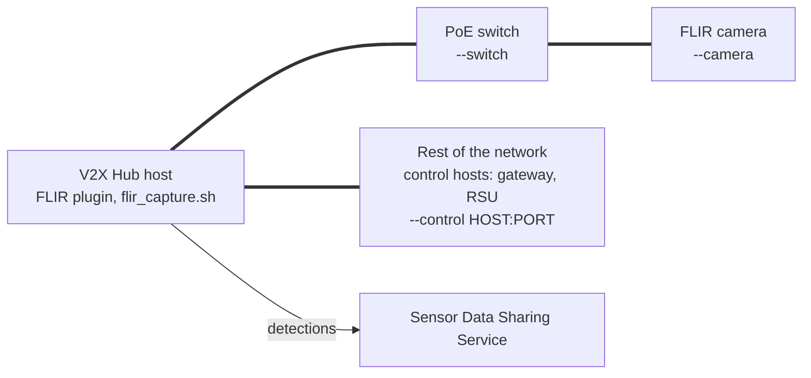
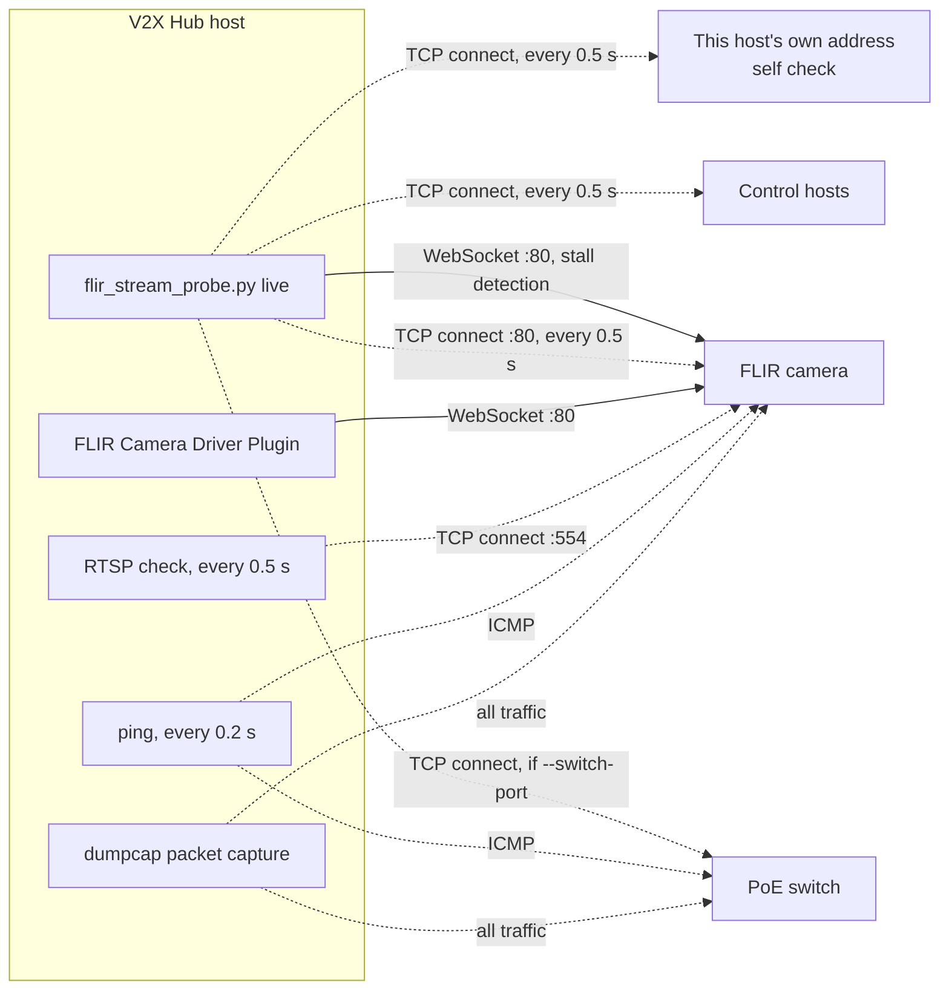
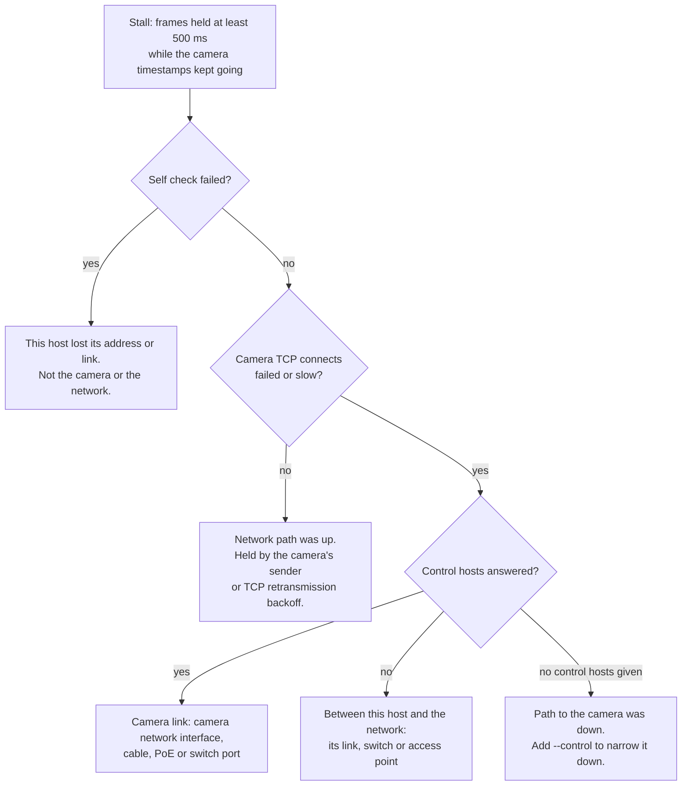

# FLIR Camera Driver Plugin Scripts

| Script | Purpose |
|---|---|
| `mockFLIRCamera.py` | Mock FLIR camera WebSocket for functionality testing (see the plugin README). |
| `flir_stream_probe.py` | Detects camera link stalls from outside the plugin and helps pinpoint where frames are held. |
| `flir_capture.sh` | Runs the probe unattended together with ping, an RTSP port check and a packet capture, and bundles the evidence for each stall. |

## Camera link stalls

The camera streams tracking data over a WebSocket (TCP). If packets are lost on the camera link, TCP holds back everything after the lost packet until a retransmission gets through, so detections stop for a few seconds and then arrive all at once. Downstream services discard detections that late, which shows up as a gap followed by a burst on the detection topic.

## Setup overview

The network. The camera streams detections to the FLIR plugin on the V2X Hub host; the plugin forwards them to the Sensor Data Sharing Service, which discards detections that arrive late.



What `flir_capture.sh` runs on the V2X Hub host, and what each part connects to, pings or captures. Solid arrows are WebSocket subscriptions, dotted arrows are checks. Comparing which checks failed during a stall shows where the frames were held. Not shown: `ip monitor`, which logs this host's own link and address changes.



| Check | Run by | Shows |
|---|---|---|
| WebSocket subscription | `flir_stream_probe.py live` | stalls and late bursts, seen independently of the plugin |
| TCP connects to the camera's WebSocket port | `flir_stream_probe.py live` | whether the camera accepted new connections during the stall |
| TCP connects to control hosts | `flir_stream_probe.py live` | whether the rest of the network was reachable at the same time |
| TCP connects to this host's own address | `flir_stream_probe.py live` | whether this host lost its own address or link |
| ICMP ping to the camera and the switch | `flir_capture.sh` | whether only the camera stopped answering while the switch still did |
| TCP connects to the camera's RTSP port | `flir_capture.sh` | whether the camera's other services stopped too |
| Packet capture | `flir_capture.sh` (`dumpcap`) | whether packets stopped, were retransmitted, or were delayed |
| Link and address log | `flir_capture.sh` (`ip monitor`) | whether this host's interface went down or changed address |

## flir_stream_probe.py

Uses only the Python standard library (3.8+).

### live

Subscribes to the camera as a second, independent client (it can run next to V2X Hub) and at the same time keeps opening TCP connections to the camera and to optional control hosts:

```shell
python3 flir_stream_probe.py live --host 192.168.55.183 \
    --control 192.168.55.1:80 --control 192.168.55.125:22
```

The examples in this document use these addresses; replace them with yours:

* `192.168.55.183`: the FLIR camera (WebSocket on port 80).
* `192.168.55.1:80`: the gateway, a control host. Any other machine on the network with an open TCP port works; add more with extra `--control HOST:PORT` options, e.g. another host on the camera's switch.
* `192.168.55.125:22`: this PC, the host running the probe, as a self check (needs an open port, e.g. SSH).

A `--control` that is one of this host's own addresses is probed as a *self* check, which shows whether this host lost its own network address (link down, Wi-Fi disconnected, or a user-private NetworkManager connection taken down when the user logs out). Use other machines, such as the gateway, as controls.

For each stall it prints whether the camera stayed reachable and how the backlog arrived at the TCP level, and writes `events.jsonl`, `frames.csv`, `chunks.csv` and `probes.csv` (every connect probe with its error, e.g. `ENETUNREACH`) to a `flir_probe_<date>_<time>/` directory. It also reports any period with no data at all, not even the camera's 60 s keepalive ping (`--silence-ms`, default 90000), so outages are caught even while nothing is tracked:

* Self check failed too: this host lost its network address or interface; the camera and the network were not the cause.
* Camera unreachable while the control host answered: packets were lost between the switch and the camera (camera network interface, its cable, PoE link or switch port).
* Camera and control hosts all unreachable while this host kept its address: the problem is between this host and the rest of the network (its link to the switch or Wi-Fi access point, or that equipment itself).
* Camera reachable throughout: the network path was up; frames were held by the camera's sender or by TCP retransmission backoff.



If V2X Hub sees a stall at a time when the probe did not, the frames were held on the V2X Hub host. Running the probe on a laptop on the same switch separates the camera's link from the V2X Hub host's link.

### analyze

Finds stalls in existing logs and cross-checks them:

```shell
python3 flir_stream_probe.py analyze --v2xhub <v2xhub log> --sdss <sensor data sharing service log> \
    --other-traffic <kafka export of another topic, e.g. v2xhub_bsm_in.log> --probe-events <live run>/events.jsonl
```

It reads the plugin's DEBUG `Received:` lines (plugin `LogLevel` DEBUG, single camera). Per stall it reports how many detections the Sensor Data Sharing Service discarded as stale, whether other traffic kept arriving (which rules out the V2X Hub host stalling as a whole), and whether the probe saw the same stall. Only `--v2xhub` is required; the other inputs add their columns when given.

* `--log-utc-offset H`: UTC offset in hours of the V2X Hub log timestamps (default 0, logs in UTC).
* `--csv FILE`: also write one row per stall to a CSV file.

## flir_capture.sh

Stalls can be hours apart, so evidence is usually collected unattended. `flir_capture.sh` starts, in one run directory under `flir_capture_runs/`, and keeps running after logout:

* `flir_stream_probe.py live` against the camera (and the switch, if it has an open TCP port);
* timestamped ICMP ping to the camera and to the PoE switch (or another device on the same switch), to show whether only the camera stops answering;
* TCP connect checks to the camera's RTSP port, to show whether its other services stop too;
* a rotating packet capture (`dumpcap`) of all traffic to and from the camera and the switch, to show whether packets stop completely, are retransmitted, or are delayed;
* a log of this host's own link and address changes.

It needs `tshark` (`sudo apt install tshark`), and the user running it must be allowed to capture: run `sudo usermod -aG wireshark $USER` once, then log out and back in. `start` checks this, the host clock's NTP synchronization, and the free disk space before starting.

```shell
./flir_capture.sh start --switch 192.168.55.2 --firmware V2.05 --note "switch A, port 3, cable 1"
./flir_capture.sh status    # what is running, capture size, stalls and ping losses so far
./flir_capture.sh list      # stalls, silences and late bursts found so far, with UTC times
./flir_capture.sh stop
```

`--switch` is required: the PoE switch's address, or another device plugged into the same switch, which is pinged next to the camera. Use `--switch none` to skip it. If the switch has an open TCP port (e.g. its web page), add `--switch-port 80` so the probe also uses it as a control host.

`./flir_capture.sh help` lists all options (camera address, extra control and ping hosts, RTSP port, capture interface, ring buffer size). The camera's WebSocket is expected on port 80. The capture keeps the newest 100 files of 100 MB by default, so copy out what you need soon after an event.

After a stall, cut out the evidence for it:

```shell
./flir_capture.sh extract 2026-11-13T15:15:02.120Z     # time from "list", UTC
```

This writes `flir_capture_runs/<run>/events/<time>/` and a `.tar.gz` of it, with the packet capture of the minute around the event, the ping, RTSP and probe records for the same window, the run's notes, and a `summary.txt`:

* the longest gaps in packets from the camera;
* TCP retransmissions, duplicate ACKs, zero windows and resets;
* TCP connection attempts to the camera answered or not;
* ping requests and replies per host.

When testing changes to the network path (another switch, port or cable), start a new run for each setup and record it with `--note`, so the runs can be compared.

## Running on a virtual machine

If the probe and capture run in a virtual machine with a NAT network adapter, the hypervisor relays TCP connections and the capture does not show the camera's real retransmissions. Use a bridged adapter or a physical machine.

## Running as a service

`flir_capture_setup/` installs `flir_capture.sh` as a systemd service that starts on boot and runs on weekdays 07:00 to 18:00 local time, with a 20 GB capture ring by default. Run `flir_capture_setup/install.sh`: it asks for the camera, switch and control addresses, ports and capture size, showing a default for each, checks that they answer, shows the resulting command and installs after confirmation. See `flir_capture_setup/README.md`.

Each weekday start creates a new run directory, and old runs are not deleted. With the default 20 GB ring, each run can reach 20 GB, and `start` refuses to begin when less than 24 GB is free (the service then retries every 30 s). Copy out the bundles you need and delete old run directories under `flir_capture_runs/` regularly.
