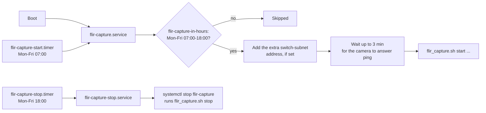

# FLIR capture setup

Runs `../flir_capture.sh` as a systemd service: it starts on boot and on weekdays at 07:00, stops at 18:00 (local time), survives reboots, and keeps 20 GB of packet capture (200 x 100 MB) per run by default. See `../README.md` for what the capture checks.

## Install

```shell
./install.sh             # asks for the addresses, checks them, installs after confirmation
./install.sh --dry-run   # asks, then prints the service file; installs nothing
./install.sh --yes       # reinstalls with the saved answers, without asking
```

`install.sh` asks the questions below, showing the default in brackets, e.g. `[554]`, or `[none]` for an optional value left empty. Press Enter to keep it, or type `-` or `none` to leave an optional value empty. The answers are saved in `/etc/flir-capture/site.conf` and become the defaults next time, so rerun `install.sh` to change them.

```text
FLIR camera IP address (WebSocket on port 80) [192.168.55.183]: 192.168.55.111
Network interface that reaches the camera (captured on) [enp60s0]:
PoE switch IP, pinged next to the camera (or another device on the same switch; none to skip): 192.168.0.239
Open TCP port on the switch, e.g. 80 for its web page [none]: 80
...
Camera RTSP port, checked with TCP connects (0 to skip) [554]:
Packet capture kept per run, in GB (the oldest 100 MB file is overwritten) [20]:
```

| Question | Used for | Default the first time |
|---|---|---|
| User the service runs as | runs the capture; added to the `wireshark` group | you |
| FLIR camera IP address | `--camera`: WebSocket (port 80), connect checks, ping, RTSP check, capture | 192.168.55.183 (`flir_capture.sh`'s default) |
| Network interface | `--iface`: the interface captured on | the one routing to the camera |
| PoE switch IP, or `none` | `--switch`: pinged and captured next to the camera | none, an answer is required |
| Open TCP port on the switch | `--switch-port`: also used as a control host by the probe | 80 if the switch answers on it, else none |
| Extra address to reach the switch | added to the interface at each start, for a switch on another subnet (e.g. still on its factory address) | none |
| NetworkManager connection | saves that extra address permanently | the interface's active connection |
| Control hosts, `HOST[:PORT]` | `--control`, e.g. the gateway or RSU; port 80 if left out | the default gateway, port 80 |
| This host's own address, `HOST[:PORT]` | `--control` self check, needs an open port; port 22 (SSH) if left out | this host's address, port 22 |
| Camera RTSP port | `--rtsp-port`, 0 to skip | 554 |
| Packet capture per run, GB | `--ring-files`, in 100 MB files | 20 |
| Camera firmware, note | recorded in each run's `notes.txt` | none |

Before asking for confirmation it pings the camera and switch, tries a TCP connect to the camera's ports and each control host, and checks the free disk space, and warns about any problem. It then:

- installs `tshark` and allows members of the `wireshark` group to capture, and adds the user to that group;
- saves the extra address in the NetworkManager connection, if given;
- generates `/etc/systemd/system/flir-capture.service` from `systemd/flir-capture.service.in`, and installs the timers, the stop service and `/usr/local/bin/flir-capture-in-hours`;
- enables everything and restarts `flir-capture.service`. A run in progress is stopped and a new run starts, unless it is outside the weekday hours.

## Schedule



If `flir_capture.sh start` fails, for example because the disk is too full, the service retries every 30 s.

## Example site

The first site this ran at, for reference:

| Role | IP |
|---|---|
| This host | 192.168.55.52 (enp60s0), plus 192.168.0.52/24 to reach the switch |
| FLIR camera | 192.168.55.111 |
| PoE switch | 192.168.0.239 (factory address), port 80 |
| RSU (camera time source) | 192.168.55.20, port 80 |
| Gateway | 192.168.55.1, port 80 |

## Files

- `install.sh`: asks for the site's addresses and installs everything below
- `systemd/flir-capture.service.in`: template for `/etc/systemd/system/flir-capture.service`, the collection run
- `systemd/flir-capture-start.timer`, `flir-capture-stop.timer`, `flir-capture-stop.service` -> `/etc/systemd/system/`
- `flir-capture-in-hours` -> `/usr/local/bin/`: the weekday-hours check used by the service

## Check

`systemctl status flir-capture`, `systemctl list-timers 'flir-capture-*'`, `../flir_capture.sh status`.

## Disk

Every weekday start creates a new run directory of up to the capture size (20 GB by default), and old runs are not deleted. `start` refuses to begin with less than the capture size plus 20% free (24 GB by default) (the service then retries every 30 s), so delete old runs under `../flir_capture_runs/` regularly.
